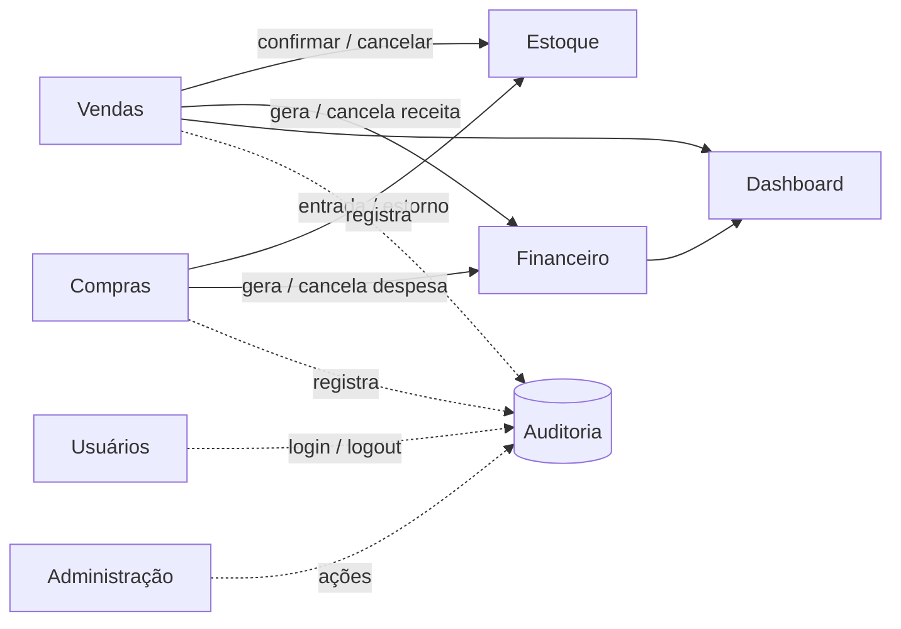

# 🧩 ERP Modular

Sistema de gestão empresarial modular, com **API REST em Django** e **interface em React + TypeScript**.
São **13 módulos integrados**: uma venda confirmada baixa o estoque e gera a receita no financeiro automaticamente.


---

## 📌 Sumário

- [Módulos](#-módulos)
- [Como os módulos se conversam](#-como-os-módulos-se-conversam)
- [Tecnologias](#-tecnologias)
- [Estrutura do projeto](#-estrutura-do-projeto)
- [Como rodar localmente](#-como-rodar-localmente)
- [Testes](#-testes)
- [Segurança](#-segurança)
- [Principais rotas da API](#-principais-rotas-da-api)
- [Decisões de projeto](#-decisões-de-projeto)
- [Roadmap](#-roadmap)

---

## 📦 Módulos

| # | Módulo | O que faz | Back-end | Front-end |
|---|--------|-----------|:--------:|:---------:|
| 1 | **Usuários / Autenticação** | Cadastro, login JWT, perfil, avatar, confirmação de e-mail, recuperação de senha, logout com blacklist, controle de sessões, OAuth Google/GitHub | ✅ | ⚠️ Login e cadastro prontos; botões OAuth só visuais |
| 2 | **Dashboard** | Faturamento, lucro, contas a pagar/receber, clientes ativos, produtos mais vendidos, gráfico de vendas, atividades recentes, próximos eventos | ✅ | ✅ |
| 3 | **Clientes (CRM)** | CRUD, pessoa física/jurídica, validação de CPF/CNPJ, endereço (ViaCEP), busca e paginação | ✅ | ✅ |
| 4 | **Produtos** | CRUD, SKU, código de barras, categoria, marca, fornecedor, preços, imagem | ✅ | ✅ |
| 5 | **Estoque** | Saldo por produto, entradas, saídas, ajustes, transferências, histórico e alerta de estoque baixo | ✅ | ✅ |
| 6 | **Financeiro** | Receitas e despesas, parcelas, resumo de fluxo de caixa, lançamentos automáticos | ✅ | ✅ |
| 7 | **Vendas** | Pedido com itens, total e desconto, confirmação, cancelamento, validação de estoque | ✅ | ✅ |
| 8 | **Compras** | Pedido ao fornecedor com itens, confirmação, cancelamento, entrada automática no estoque | ✅ | ✅ |
| 9 | **RH** | Funcionários, departamentos, cargos, férias, escalas e documentos (acesso restrito) | ✅ | ✅ |
| 10 | **Relatórios** | Exportação em CSV, Excel e PDF com filtros | ✅ | ✅ |
| 11 | **Agenda** | Eventos, convidados, lembretes, notificações com sino | ✅ | ✅ |
| 12 | **Tarefas + Comunicados** | Kanban com arrastar e soltar, solicitações entre setores, checklist, comentários e mural de avisos | ✅ | ✅ |
| 13 | **Administração** | Gestão de usuários e registro de atividades (auditoria), acesso restrito | ✅ | ✅ |

---

## 🔗 Como os módulos se conversam



- **Venda confirmada:** baixa o estoque e cria a receita no financeiro. Se cancelada, estorna os dois.
- **Compra confirmada:** dá entrada no estoque e cria a despesa. Se cancelada, estorna os dois.
- **Auditoria:** login, logout, tentativas de login recusadas, vendas, compras e ações de administração ficam registradas (quem, o quê, quando e de qual IP).

---

## 🛠 Tecnologias

**Back-end**
- Python, Django 6, Django REST Framework
- SimpleJWT (com blacklist), social-auth (Google e GitHub)
- django-filter, django-cors-headers, python-decouple
- SQLite no desenvolvimento

**Front-end**
- React, TypeScript, Vite
- Tailwind CSS 4
- React Router, axios, recharts, framer-motion, lucide-react

**Qualidade**
- Testes automáticos do Django (APITestCase)
- Postman para testes manuais dos primeiros módulos
- Commits no padrão `feat(modulo): descrição` e `fix(modulo): descrição`

---

## 🗂 Estrutura do projeto

```text
erp_modular/
├── core/                  # configurações do Django e rotas principais
├── apps/                  # um app por módulo
│   ├── usuarios/          ├── clientes/       ├── produtos/
│   ├── estoque/           ├── vendas/         ├── financeiro/
│   ├── compras/           ├── dashboard/      ├── relatorios/
│   ├── rh/                ├── agenda/         ├── tarefas/
│   ├── comunicados/       └── administracao/
├── frontend/
│   └── src/
│       ├── pages/         # telas (Clientes.tsx, Vendas.tsx, Administracao.tsx...)
│       ├── components/    # componentes reutilizáveis e por módulo
│       ├── services/      # chamadas à API (axios)
│       └── types/         # tipos TypeScript
├── requirements.txt
└── manage.py
```

---

## 🚀 Como rodar localmente

### 1. Clonar e preparar o back-end

```powershell
git clone https://github.com/PaNiiCz/erp-modular.git
cd erp-modular
python -m venv venv
venv\Scripts\activate
pip install -r requirements.txt
```

### 2. Criar o arquivo `.env` na raiz

As credenciais de login social são lidas do `.env`. Preencha com as suas (crie um app OAuth no GitHub e no Google):

```env
GITHUB_CLIENT_ID=
GITHUB_CLIENT_SECRET=
GOOGLE_CLIENT_ID=
GOOGLE_CLIENT_SECRET=
```

### 3. Banco de dados e usuário administrador

```powershell
python manage.py migrate
python manage.py createsuperuser
```

### 4. Rodar o back-end

```powershell
python manage.py runserver
```

API em `http://127.0.0.1:8000`.

### 5. Rodar o front-end (em outro terminal)

```powershell
cd frontend
npm install
npm run dev
```

Aplicação em `http://localhost:5173`.

---

## ✅ Testes

Cada app tem seus testes. Para rodar:

```powershell
python manage.py test apps.administracao.tests
python manage.py test apps.administracao.test_auditoria
python manage.py test apps.comunicados.tests
python manage.py test apps.tarefas.test_apoio
```

| Suíte | Testes | Cobre |
|-------|:------:|-------|
| `apps.administracao.tests` | 16 | Permissões, proteção contra auto-alteração, bloqueio de superusuário, ativar/desativar, encerramento de sessão, filtros e resumo |
| `apps.administracao.test_auditoria` | 3 | Registro de login, login recusado e logout |
| `apps.comunicados.tests` | 12 | Publicação restrita, leitura, fixados e filtros |
| `apps.tarefas.test_apoio` | 3 | Rotas de apoio (usuário atual, setores, usuários) |

Os módulos anteriores foram validados manualmente no Postman. O front-end é verificado com:

```powershell
cd frontend
npm run build
```

---

## 🔐 Segurança

**O que já existe**
- Autenticação JWT com refresh token e **blacklist** (logout invalida a sessão)
- Controle e encerramento de sessões ativas
- Confirmação de e-mail e recuperação de senha por link com token
- Login social com Google e GitHub
- Áreas restritas (**RH** e **Administração**) protegidas **no back-end**, com resposta 403, e não só escondidas no menu
- Documentos do RH em pasta privada, fora do Git, com download autenticado
- Administração com proteções: ninguém altera a própria conta, só superusuário altera outro superusuário e desativar um usuário encerra as sessões dele
- Auditoria das ações importantes
- Segredos de OAuth no `.env` (ignorado pelo Git)

**Pendente antes de publicar** (ver [Roadmap](#-roadmap))
- Reduzir a duração do token de acesso (hoje 1 dia, para facilitar testes)
- Mover a `SECRET_KEY` para o `.env` e ajustar `DEBUG`, hosts e CORS de produção
- Aprovação de contas novas por um administrador e limite de tentativas de login
- Permissões por papel mais detalhadas

---

## 🌐 Principais rotas da API

Todas começam em `http://127.0.0.1:8000/api/` e exigem login (exceto cadastro, login e recuperação de senha).

| Grupo | Rotas |
|-------|-------|
| Usuários | `usuarios/cadastro/`, `login/`, `login/refresh/`, `perfil/`, `logout/`, `avatar/`, `sessoes/`, `recuperar-senha/`, `confirmar-email/<uid>/<token>/` |
| Dashboard | `dashboard/resumo/`, `produtos-mais-vendidos/`, `grafico-vendas/`, `atividades-recentes/` |
| Clientes | `clientes/` |
| Estoque | `estoque/alertas/` |
| Financeiro | `financeiro/lancamentos/resumo/` |
| RH | `rh/acesso/`, `rh/funcionarios/`, `rh/departamentos/`, `rh/cargos/`, `rh/ferias/`, `rh/escalas/`, `rh/documentos/` |
| Agenda | `agenda/eventos/`, `agenda/notificacoes/`, `agenda/usuarios/` |
| Tarefas | `projetos/`, `tarefas/` (`mover/`, `minhas/`, `resumo/`), `checklist/`, `comentarios/`, `apoio/eu/`, `apoio/setores/`, `apoio/usuarios/` |
| Comunicados | `comunicados/` (`marcar-lido/`, `nao-lidos/`, `leituras/`) |
| Administração | `administracao/acesso/`, `resumo/`, `usuarios/` (`ativar/`, `desativar/`, `tornar-admin/`, `remover-admin/`), `atividades/` |

---

## 🧠 Decisões de projeto

- **Integração por signals:** estoque e financeiro são atualizados no back-end, sem depender do front-end chamar várias rotas.
- **Cálculos no banco:** os totais do dashboard usam agregação (`Sum`) para evitar consultas repetidas (N+1).
- **Comunicação interna sem chat:** solicitações entre setores (dentro de Tarefas) e um mural de comunicados resolvem a necessidade com menos complexidade. Tempo real ficou para a fase de extras.
- **Lembretes sem Celery:** o lembrete vira notificação quando o usuário consulta as notificações.
- **Padrão visual único:** interface em vidro fosco (glassmorphism), com componentes compartilhados (`ConfirmModal`, `SelectCampo`) para manter o mesmo comportamento em todas as telas.
- **Permissão no back-end:** o menu apenas reflete o que a API já autoriza.

---

## 🗺 Roadmap

- [ ] Segurança de produção: token curto com renovação automática, `SECRET_KEY` no `.env`, `DEBUG` desligado, aprovação de contas novas e limite de tentativas de login
- [ ] Ponte JWT dos botões de login social
- [ ] Preview da imagem do produto na edição
- [ ] Ligar a Solicitação ao Pedido de Compra
- [ ] Contador de comunicados não lidos no menu e criação de projeto pela tela de Tarefas
- [ ] PostgreSQL, Docker e GitHub Actions
- [ ] Documentação Swagger/OpenAPI e coleção do Postman
- [ ] Deploy
- [ ] Tempo real (WebSockets) e notificações por e-mail

---

## 👤 Autor

Desenvolvido por **PaNiiCz** como projeto central de portfólio, construído em módulos, com um commit por etapa.